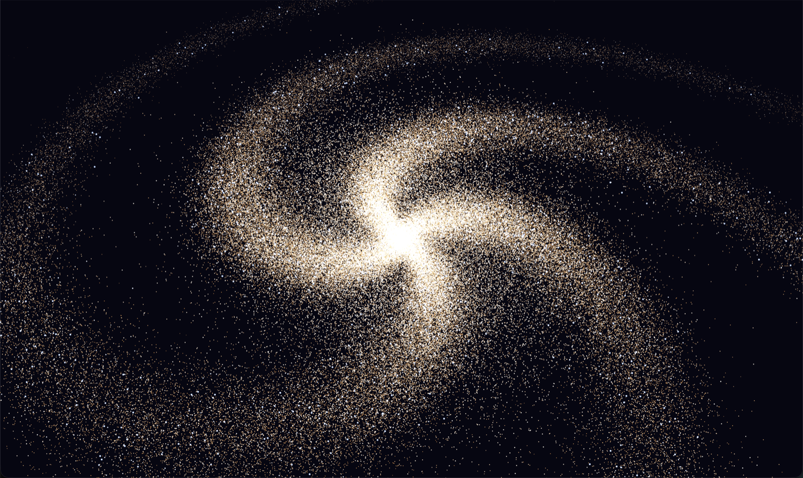

# Stellar Engine

A cosmic exploration game engine in C++20 + Vulkan 1.3. This is the milestone 1 demo: it renders a procedurally generated spiral galaxy.



## Current status

- 200,000 procedurally generated stars. The same seed always gives the same galaxy.
- Spiral arms use a logarithmic spiral, the disc uses an exponential distribution, and the central bulge uses a Gaussian distribution.
- Star colours come from a temperature distribution (M/K/G/F/A/B/O) mapped through blackbody colours.
- Vulkan 1.3 dynamic rendering (no VkRenderPass), synchronization2, and two frames in flight.
- Additive-blended point sprites with distance falloff.
- Measured on an Apple M4 Pro (MoltenVK): 200,000 stars at a steady 120 fps (vsync limit). Generation takes about 13 ms.

## Build

macOS:

```sh
brew install cmake molten-vk vulkan-loader vulkan-headers glfw glm glslang
cmake -S . -B build -DCMAKE_BUILD_TYPE=Release
cmake --build build -j
./build/stellar                 # default seed
./build/stellar 0x1234 500000   # custom seed and star count
```

Linux/Windows: install the Vulkan SDK, GLFW, and GLM, then build with the same commands.

Controls: drag with the left mouse button to rotate, and scroll to zoom.

## Directory layout

```
src/universe/  Procedural generation (galaxy -> star system -> planet)
src/render/    Vulkan backend
shaders/       GLSL, compiled to SPIR-V at build time
```

## Roadmap

| Milestone | Content | Status |
|---|---|---|
| 1 | Vulkan pipeline + procedural galaxy | Done |
| 2 | 64-bit hierarchical coordinates + floating origin: fly seamlessly from galaxy view into a star system | |
| 3 | Planet surface LOD + ray-marched atmospheric scattering | |
| 4 | First encounter with a 2D civilization | |
| 5 | Hardware ray tracing, 4D civilization slice rendering | |
